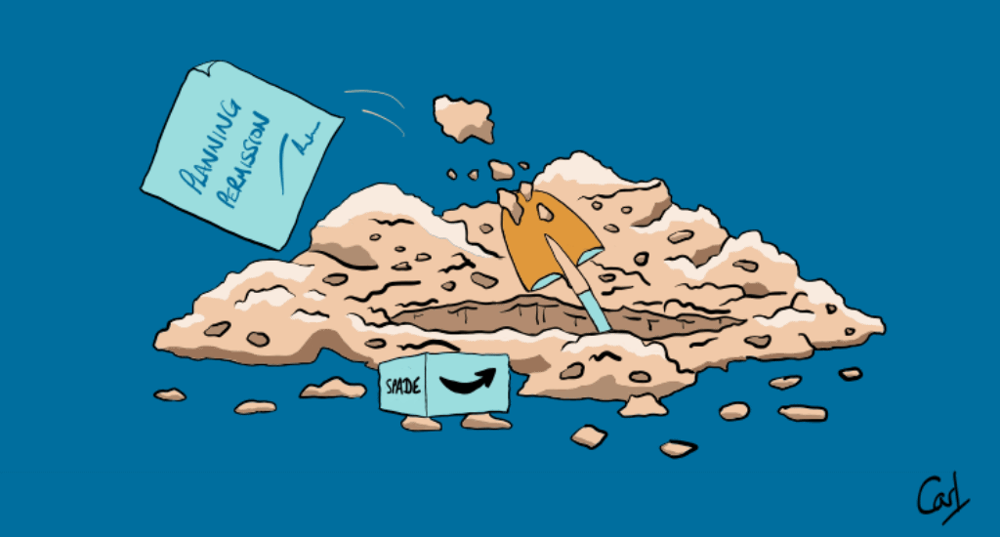

{fig-alt="A spade is seen tossing fresh dirt from a deep hole. A granted planning permission and an empty new spade box lie nearby."}

In [House Sales](/project/sw10) I looked at how a series of events damped down sales. By combining these sales data with planning applications I'd like to see if homeowners 'start digging' when they can't sell.

Planning data is harvested with the kind permission of The Royal Borough of Kensington and Chelsea (RBKC). The code for these code chunks is not rendered out of courtesy to RBKC.

```{r}
#| label: libraries

library(conflicted)
library(tidyverse)
library(rvest)
library(sparqlr)
library(quanteda)
library(quanteda.textstats)
library(clock)
library(fabletools)
library(feasts)
library(ggtime)
library(tsibble)
library(DT)
library(ggfoundry)
library(paletteer)
library(htmlwidgets)
library(usedthese)
library(here)

conflict_prefer_all("dplyr", quiet = TRUE)
conflict_prefer("as_date", "lubridate")
```

```{r}
#| label: theme
#| dev.args: { bg: "transparent" }

theme_set(theme_bw())

pal_name <- "wesanderson::Darjeeling2"

pal <- paletteer_d(pal_name)

display_palette(pal, pal_name)
```

```{r}
#| label: scrape
#| eval: false
#| include: false

url <- "https://www.rbkc.gov.uk/planning/searches/default.aspx?adv=0&simple=sw10&simpleBatch=200&simSubmit=Search&pgdec="

last_page <- str_c(url, 1) |>
  read_html() |>
  html_element("#tabs-planning-2 strong:nth-child(3)") |>
  html_text() |>
  as.numeric() %/%
  200 +
  1

links_df <- map(seq_len(last_page), \(i) {
  table <- str_c(url, i) |>
    read_html() |>
    html_element("#tabs-planning-2")

  link <- table |>
    html_elements("td a") |>
    html_attr("href")

  tibble(link = str_c("https://www.rbkc.gov.uk/planning/searches/", link))
}) |>
  list_rbind()
```

```{r}
#| label: iterate
#| eval: false
#| include: false
#| cache: true

case_df <- links_df$link |>
  map(
    \(j) {
      j |>
        read_html() |>
        html_elements(
          "#property-details, #applicant-details,
          #proposal-details, #decision-details,
          #planning-dept-contact"
        ) |>
        html_table() |>
        bind_rows() |>
        mutate(link = j)
    },
    .progress = TRUE
  ) |>
  list_rbind()

write_rds(case_df, "case.rds")
```

```{r}
#| label: rename
#| include: false

plan_colnames <- c(
  property_case = "Case reference:",
  property_add = "Address:",
  property_ward = "Ward:",
  property_dist = "Polling district:",
  property_list = "Listed Building Grade:",
  property_cons = "Conservation area:",
  app_name = "Applicant's name:",
  app_comp = "Applicant company name:",
  app_cont = "Contact address:",
  proposal_type = "Application type:",
  proposal_dev = "Proposed development",
  decision = "Decision:",
  dec_date = "Decision date:",
  dec_reason = "Conditions and reasons:",
  planning_off = "Planning case officer:",
  planning_team = "Planning team:",
  link = "link"
)
```

```{r}
#| label: read

case_df <- read_rds(here("project", "planning", "case.rds"))
```

The data need a bit of wrangling. And there is also the opportunity to try the newest column-wise enhancements to mutate: `mutate_if` and `mutate_at` have been superseded by `mutate` with `across`.

```{r}
#| label: wrangle

wide_df <- case_df |>
  pivot_wider(names_from = X1, values_from = X2) |>
  select(all_of(plan_colnames))

tidy_df <- wide_df |>
  mutate(across(where(is.character), str_trim)) |>
  mutate(
    dec_date = date_parse(dec_date, format = "%d %b %Y"),
    dec_year = get_year(dec_date),
    proposal_dev = str_to_lower(proposal_dev) |>
      na_if("") |>
      replace_na("None"),
    decision = na_if(decision, "") |>
      replace_na("Other") |>
      str_replace("/", " / "),
    dec_lump = fct_lump_prop(decision, prop = 0.03)
  )

tidy_df |>
  count(Decision = dec_lump, sort = TRUE, name = "Count")
```

{quanteda} [@quanteda] to look at key words in context (kwic).

```{r}
#| label: phrases
#| include: false

phrases <- phrase(c(
  "not exceed",
  "not result in",
  "mitigate the effects of, and adapt to,",
  "fail to preserve",
  "fail to comply with",
  "by reason of",
  "removal would be",
  "visually intrusive",
  "out of character",
  "contrary to",
  "not been demonstrated that",
  "neither preserve nor enhance",
  "not preserve or enhance",
  "in breach of",
  "negative impact on",
  "substandard",
  "harm the"
))

dt1 <- tidy_df |>
  filter(str_detect(decision, "Refuse")) |>
  corpus(
    text_field = "dec_reason",
    docid_field = "property_case",
    doc_vars = c("dec_date", "proposal_type", "decision", "dec_year")
  ) |>
  tokens() |>
  kwic(pattern = phrases, window = 10) |>
  as_tibble() |>
  select(-from, -to, -pattern) |>
  datatable()
```

```{r}
#| label: widget
#| include: false

saveWidget(dt1, file = "dt1.html", selfcontained = TRUE)
```

```{=html}
<iframe seamless src="/project/planning/dt1.html" width="100%" height="500"></iframe>
```

I'd like to review planning applications by theme. So I'll first need to get a sense of what the themes are by plotting the words which appear most frequently.

```{r}
#| label: dfm

plus_words <-
  c(
    "new",
    "pp",
    "two",
    "one",
    "dated",
    "withdrawn",
    "flat",
    "x",
    "permission",
    "rear",
    "first",
    "second",
    "planning",
    "floor",
    "erection"
  )

words <- tidy_df |>
  corpus(text_field = "proposal_dev") |>
  tokens(remove_numbers = TRUE, remove_punct = TRUE) |>
  dfm() |>
  dfm_remove(c(stopwords("english"), plus_words)) |>
  textstat_frequency() |>
  slice_head(n = 30) |>
  mutate(feature = fct_reorder(feature, frequency))

ggplot(words, aes(frequency, feature)) +
  geom_col(fill = pal[4]) +
  labs(
    x = NULL,
    y = NULL,
    title = "Frequent Planning Proposal Words",
    caption = "Source: RBKC Planning Search"
  )
```

Now I can create a theme feature.

```{r}
#| label: match

remapped_df <- tidy_df |>
  mutate(
    theme = case_when(
      str_detect(proposal_dev, "basem|excav") ~ "Basement or Excavation",
      str_detect(proposal_dev, "xten|vatory|torey") ~
        "Extension, Conservatory \nor Storey",
      str_detect(proposal_dev, "windo|doo") ~ "Windows or Doors",
      str_detect(proposal_dev, "roof") ~ "Roof",
      when_any(
        str_detect(proposal_dev, "rrac|dsc|garde"),
        str_detect(proposal_type, "Tree")
      ) ~ "Trees, Landscaping, \nGarden or Terrace",
      .default = "Other"
    ),
    outcome = case_when(
      str_detect(decision, "Gran|No Ob|Accep|Lawf") ~ "Positive",
      str_detect(decision, "Refus") ~ "Refuse",
      str_detect(decision, "Withdr") ~ "Withdrawn",
      .default = "Other"
    )
  )
```

I also want to compare house sales with planning applications over time. So, I'll reuse the SPARQL query from [House Sales](/project/sw10), this time run with {sparqlr}.

```{r}
#| label: compare
#| cache: true

endpoint <- "https://landregistry.data.gov.uk/landregistry/query"

query <- 'PREFIX  text: <http://jena.apache.org/text#>
PREFIX  ppd:  <http://landregistry.data.gov.uk/def/ppi/>
PREFIX  lrcommon: <http://landregistry.data.gov.uk/def/common/>

SELECT  ?item ?ppd_propertyAddress ?ppd_hasTransaction ?ppd_pricePaid ?ppd_transactionCategory ?ppd_transactionDate ?ppd_transactionId ?ppd_estateType ?ppd_newBuild ?ppd_propertyAddressCounty ?ppd_propertyAddressDistrict ?ppd_propertyAddressLocality ?ppd_propertyAddressPaon ?ppd_propertyAddressPostcode ?ppd_propertyAddressSaon ?ppd_propertyAddressStreet ?ppd_propertyAddressTown ?ppd_propertyType ?ppd_recordStatus

WHERE
{ ?ppd_propertyAddress text:query _:b0 .
  _:b0 <http://www.w3.org/1999/02/22-rdf-syntax-ns#first> lrcommon:postcode .
  _:b0 <http://www.w3.org/1999/02/22-rdf-syntax-ns#rest> _:b1 .
  _:b1 <http://www.w3.org/1999/02/22-rdf-syntax-ns#first> "( SW10 )" .
  _:b1 <http://www.w3.org/1999/02/22-rdf-syntax-ns#rest> _:b2 .
  _:b2 <http://www.w3.org/1999/02/22-rdf-syntax-ns#first> 3000000 .
  _:b2 <http://www.w3.org/1999/02/22-rdf-syntax-ns#rest> <http://www.w3.org/1999/02/22-rdf-syntax-ns#nil> .
  ?item ppd:propertyAddress ?ppd_propertyAddress .
  ?item ppd:hasTransaction ?ppd_hasTransaction .
  ?item ppd:pricePaid ?ppd_pricePaid .
  ?item ppd:transactionCategory ?ppd_transactionCategory .
  ?item ppd:transactionDate ?ppd_transactionDate .
  ?item ppd:transactionId ?ppd_transactionId

  OPTIONAL { ?item ppd:estateType ?ppd_estateType }
  OPTIONAL { ?item ppd:newBuild ?ppd_newBuild }
  OPTIONAL { ?ppd_propertyAddress lrcommon:county ?ppd_propertyAddressCounty }
  OPTIONAL { ?ppd_propertyAddress lrcommon:district ?ppd_propertyAddressDistrict }
  OPTIONAL { ?ppd_propertyAddress lrcommon:locality ?ppd_propertyAddressLocality }
  OPTIONAL { ?ppd_propertyAddress lrcommon:paon ?ppd_propertyAddressPaon }
  OPTIONAL { ?ppd_propertyAddress lrcommon:postcode ?ppd_propertyAddressPostcode }
  OPTIONAL { ?ppd_propertyAddress lrcommon:saon ?ppd_propertyAddressSaon }
  OPTIONAL { ?ppd_propertyAddress lrcommon:street ?ppd_propertyAddressStreet }
  OPTIONAL { ?ppd_propertyAddress lrcommon:town ?ppd_propertyAddressTown }
  OPTIONAL { ?item ppd:propertyType ?ppd_propertyType }
  OPTIONAL { ?item ppd:recordStatus ?ppd_recordStatus }
}'

sales <- sparql_select(endpoint, query)
```

Let's now bind the data into one tibble and summarise the transaction volumes over time.

```{r}
#| label: bind

sales_df <- sales |>
  count(date = as_date(ppd_transactionDate), name = "volume") |>
  mutate(dataset = "Sales")

app_df <- remapped_df |>
  count(date = dec_date, name = "volume") |>
  mutate(dataset = "Planning")

summary_df <- bind_rows(app_df, sales_df) |>
  filter(date >= min(sales_df$date)) |>
  mutate(date = yearmonth(date)) |>
  summarise(volume = sum(volume), .by = c(date, dataset))
```

The visualisation below does suggest that homeowners 'start digging' when they can't sell. At least in this part of London.

```{r}
#| label: visualise

monthly_ts <- summary_df |>
  as_tsibble(key = dataset, index = date)

ggplot(monthly_ts, aes(date, volume, colour = dataset)) +
  geom_line(key_glyph = "timeseries") +
  scale_colour_manual(values = pal[c(2, 3)]) +
  labs(
    x = NULL,
    y = NULL,
    colour = NULL,
    title = "Monthly Property Transaction Volume in SW10",
    caption = "Sources: Land Registry & RBKC Planning"
  )
```

Time-series data may have an underlying trend and a seasonality pattern. I'll use the {feasts} package to decompose each time-series. Each exhibits annual seasonality which evolves over time.

```{r}
#| label: decomposition

monthly_ts |>
  model(stl = STL(volume ~ season())) |>
  components() |>
  autoplot() +
  scale_colour_manual(values = pal[c(2, 3)]) +
  labs(x = NULL, title = "Time Series Decomposition")
```

We also see some inverse correlation between the two time-series reaffirming the visual conclusion that planning applications increase when the housing market is depressed.

```{r}
#| label: correlation

monthly_ts |>
  pivot_wider(names_from = dataset, values_from = volume) |>
  CCF(Sales, Planning, lag_max = 6) |>
  autoplot() +
  labs(title = "Correlation Between Sales & Planning") +
  theme(axis.text.x = element_text(angle = 45, hjust = 1))
```

The overall volumes of planning applications and house transactions in SW10 are fairly similar.

```{r}
#| label: volumes

summary_df |>
  summarise(Count = sum(volume), .by = dataset) |>
  rename(Dataset = dataset)
```

Earlier, I added a "theme" feature to the data. So let's take a look at the volume of applications over time faceted by theme and coloured by the outcome. We see that the rise in planning applications is fuelled by basements or excavations, and work on outside landscaping and terracing. So perhaps we do 'dig' when we can't sell.

```{r}
#| label: trend

ggplot(remapped_df, aes(dec_year, fill = outcome)) +
  geom_bar() +
  facet_wrap(~theme, nrow = 2) +
  scale_fill_manual(values = pal[c(1:4)]) +
  labs(
    title = "Planning Application Themes",
    x = NULL,
    y = NULL,
    caption = "Source: RBKC Planning Search"
  )
```

## R Toolbox

Summarising below the packages and functions used in this post enables me to separately create a [toolbox visualisation](/project/box) summarising the usage of packages and functions across all posts.

```{r}
#| label: toolbox

used_here()
```
